# gcds-combobox

<!-- Auto Generated Below -->

## Overview

A searchable multi-select field that displays selected options as removable tags.

## Properties

| Property               | Attribute           | Description                                                                                                                | Type                                                | Default     |
| ---------------------- | ------------------- | -------------------------------------------------------------------------------------------------------------------------- | --------------------------------------------------- | ----------- |
| `autofocus`            | `autofocus`         | Specifies if an input element should be focused on component render.                                                       | `boolean`                                           | `false`     |
| `disabled`             | `disabled`          | Specifies if an input element is disabled or not.                                                                          | `boolean`                                           | `false`     |
| `enableSelectAll`      | `enable-select-all` | If true, a "Select All" option will be displayed at the top of the list of options.                                        | `boolean`                                           | `false`     |
| `errorMessage`         | `error-message`     | Error message for an invalid input element.                                                                                | `string`                                            | `undefined` |
| `form`                 | `form`              | The ID of the form that the input field belongs to.                                                                        | `string`                                            | `undefined` |
| `hideLabel`            | `hide-label`        | If true, the label will be visually hidden but still accessible to screen readers.                                         | `boolean`                                           | `false`     |
| `hint`                 | `hint`              | Hint displayed below the label and above the input field.                                                                  | `string`                                            | `undefined` |
| `inputId` _(required)_ | `input-id`          | Id attribute for the combobox input element.                                                                               | `string`                                            | `undefined` |
| `label` _(required)_   | `label`             | Form field label                                                                                                           | `string`                                            | `undefined` |
| `name` _(required)_    | `name`              | Name attribute for the combobox input element.                                                                             | `string`                                            | `undefined` |
| `options`              | `options`           | JSON option array, or URL returning objects with `name` and `tag` fields.                                                  | `SuggestionOption[] \| string`                      | `undefined` |
| `required`             | `required`          | Specifies if a form field is required or not.                                                                              | `boolean`                                           | `false`     |
| `selectedOptions`      | --                  | Selected options, available for programmatic updates.                                                                      | `SuggestionOption[]`                                | `[]`        |
| `validateOn`           | `validate-on`       | Set event to call validator                                                                                                | `"blur" \| "other" \| "submit"`                     | `'blur'`    |
| `validator`            | --                  | Array of validators                                                                                                        | `(string \| ValidatorEntry \| Validator<string>)[]` | `undefined` |
| `validity`             | --                  | Read-only property of the combobox, returns a ValidityState object that represents the validity states this element is in. | `ValidityState`                                     | `undefined` |
| `value`                | `value`             | Initial selected values.                                                                                                   | `string \| string[]`                                | `undefined` |

## Events

| Event        | Description                                    | Type                              |
| ------------ | ---------------------------------------------- | --------------------------------- |
| `gcdsBlur`   | Emitted when the input loses focus.            | `CustomEvent<void>`               |
| `gcdsChange` | Emitted when the input has changed.            | `CustomEvent<SuggestionOption[]>` |
| `gcdsError`  | Emitted when the element is invalid.           | `CustomEvent<object>`             |
| `gcdsFocus`  | Emitted when the input has focus.              | `CustomEvent<void>`               |
| `gcdsInput`  | Emitted when the element has received input.   | `CustomEvent<string>`             |
| `gcdsValid`  | Emitted when the input has a validation error. | `CustomEvent<object>`             |

## Methods

### `checkValidity() => Promise<boolean>`

#### Returns

Type: `Promise<boolean>`

### `getSelectedOptions() => Promise<SuggestionOption[]>`

Return a copy of the selected option objects.

#### Returns

Type: `Promise<SuggestionOption[]>`

### `getSelectedValues() => Promise<string[]>`

Return the selected option values for form and application code.

#### Returns

Type: `Promise<string[]>`

### `getValidationMessage() => Promise<string>`

#### Returns

Type: `Promise<string>`

### `selectAll() => Promise<void>`

Select every option and collapse the list.

#### Returns

Type: `Promise<void>`

### `setFocus() => Promise<void>`

Focus the search field and open its list of options.

#### Returns

Type: `Promise<void>`

### `setOptions(options: Array<Record<string, unknown>>) => Promise<void>`

Replace the option list using objects whose keys are labels and values
are option values, then retain selections that still exist.

#### Parameters

| Name      | Type                        | Description |
| --------- | --------------------------- | ----------- |
| `options` | `Record<string, unknown>[]` |             |

#### Returns

Type: `Promise<void>`

### `setSelectedOptions(items: SuggestionOption[]) => Promise<void>`

Set selected options, ignoring values that are not in the option list.

#### Parameters

| Name    | Type                 | Description |
| ------- | -------------------- | ----------- |
| `items` | `SuggestionOption[]` |             |

#### Returns

Type: `Promise<void>`

### `unselectAll() => Promise<void>`

Clear all selected options.

#### Returns

Type: `Promise<void>`

### `validate() => Promise<void>`

Run configured validators against the selected values.

#### Returns

Type: `Promise<void>`

## Shadow Parts

| Part        | Description |
| ----------- | ----------- |
| `"control"` |             |
| `"listbox"` |             |
| `"tag"`     |             |

## Dependencies

### Depends on

- [gcds-icon](../gcds-icon)
- [gcds-label](../gcds-label)
- [gcds-hint](../gcds-hint)
- [gcds-error-message](../gcds-error-message)

### Graph

```mermaid
graph TD;
  gcds-combobox --> gcds-icon
  gcds-combobox --> gcds-label
  gcds-combobox --> gcds-hint
  gcds-combobox --> gcds-error-message
  gcds-hint --> gcds-text
  gcds-error-message --> gcds-text
  gcds-error-message --> gcds-icon
  style gcds-combobox fill:#26374a,stroke:#333,stroke-width:4px
```

----------------------------------------------

*Built with [StencilJS](https://stenciljs.com/)*
